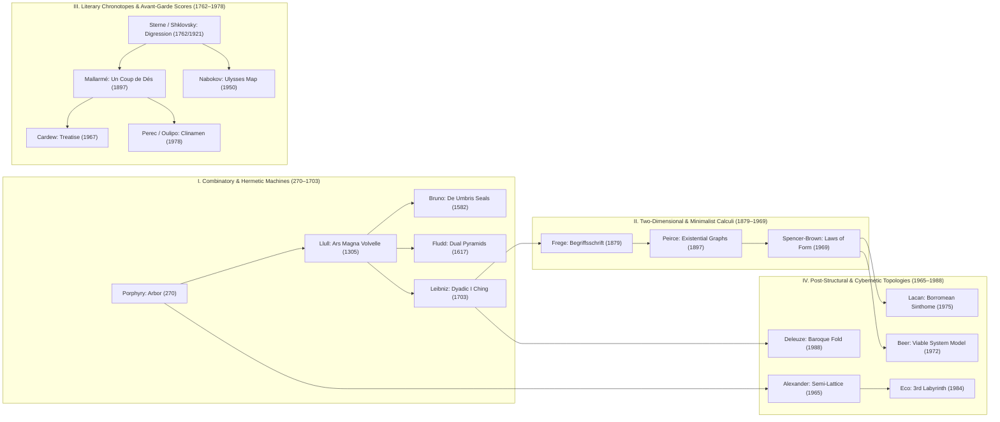

# Atlas Obscura Graphica: Curatorial Report, Process Methodology & Annotated Bibliography

> [!IMPORTANT]
> **Curatorial Premise:** Rather than rehearsing the familiar associative collage of Aby Warburg’s *Bilderatlas Mnemosyne*, this compendium isolates **operational diagrams**—visual instruments that function as *deductive calculi, ontological cleavages, combinatory engines, and narrative chronotopes*. Every plate selected operates not as a passive illustration of a preexisting text, but as an active epistemic apparatus where spatial syntax generates thought.

---

## Part I. Curatorial Selection Criteria & The Anti-Warburgian Pivot

### 1. Beyond Associative Iconology: Toward Operational Diagrammatology
In contemporary visual studies and literary theory, invocations of "unconventional knowledge visualization" almost reflexively default to Warburg’s *Mnemosyne* panels—black cloth pinboards where photographic reproductions cluster by *Pathosformel* (affective gesture). While historically foundational for art history, the Warburgian model remains **paratactic and associative**: the black space between images is an unformalized gap left to the intuition of the spectator.

To build something genuinely innovative and aligned with **philosophical, literary, historical, and progressively minimalist** inquiry, *Atlas Obscura Graphica* turns instead to the tradition that Charles Sanders Peirce, Sybille Krämer, and Frederik Stjernfelt term **Operational Diagrammatology** (*operative Bildlichkeit*). A true epistemic diagram satisfies three strict criteria:
1. **Syntactic Spatiality:** Spatial relations on the two-dimensional surface (containment, intersection, inclination, perforation, folding, or cancellation) map isomorphically to logical, temporal, or ontological relations.
2. **Manipulability (The Apparatus Condition):** One can perform regulated operations upon the figure—rotating a Llullian wheel, erasing a Spencer-Brown double cross, severing a Lacanian ring, or perturbing a Shandean digression curve—and *read off new truths* that were not explicitly deposited at the outset.
3. **Progressive Minimalism:** Across the 1,700-year arc of the compendium (c. 270 AD to 1988), the highest conceptual density repeatedly coincides with the boldest *reduction of graphical means*—culminating in systems where a single right-angled mark ($\supset$), a closed oval incision, or an incomplete 12-edge isometric armature generates an entire formal universe.

---

## Part II. Related Design & Reconstruction Processes

### 1. Adaptive Structural Molds & Foliated Salon Architecture (38 Plates)
To accommodate **all 38 plates** (including the 6 newly promoted plates: **Klee**, **Spinoza**, **Lewin**, **Hinton**, **Schlemmer**, and **Thom**) without visual fatigue, the gallery is structured by **Six Architectural Folio Chapter Dividers (`FOLIO I` – `FOLIO VI`)** that pace the 38 plates into six curated salons (`7 · 6 · 6 · 6 · 6 · 7` plates). Within each folio, **20 of the 38 plates** inhabit the canonical single-column archival card, while **18 plates** break or mutate the mold across three specialized structural archetypes in [css/styles.css](file:///Users/themainframe/Documents/antigravity/prodigal-bstd/css/styles.css) and [js/app.js](file:///Users/themainframe/Documents/antigravity/prodigal-bstd/js/app.js):

| Mold Archetype | CSS Class | Assigned Plates | Structural Rationale |
| :--- | :--- | :--- | :--- |
| **Canonical Archival Plate** | `.editorial-card` | 20 Plates (e.g., *Peirce*, *Greimas*, *Lacan*, *Serres*, *Perec*, *Nabokov*, *Kunz*, *Xenakis*, *Poincaré*, *Beer*, *Marey*, *Du Bois*, *Lewin*) | Preserves rhythmic scanning across the gallery grid while adapting the 3-button triad labels to the specific epistemic mode (`Plate / Calculus / Engine`, `Score / Protocol / Stage`, etc.). |
| **Double-Wide Treatise Spread** | `.editorial-card.mold-wide` | **Plates I, XI, XV, XXII, XXVII, XXXVIII** (*Spencer-Brown*, *Ramon Llull*, *Sterne/Shklovsky*, *Christopher Alexander*, *Minard*, *René Thom’s Cusp Catastrophe*) | Spans two columns (`grid-column: span 2`) with a side-by-side folio layout and embedded axiomatic epigraph. Essential for wide horizontal trajectories (Sterne, Minard), folded 3D bifurcation manifolds (Thom), or bipartite comparative proofs (Alexander’s Tree vs. Semi-Lattice, Spencer-Brown’s Calling vs. Crossing). |
| **Nocturnal *Camera Obscura* Plate** | `.editorial-card.mold-nocturnal` | **Plates VIII, XII, XIII, XVI, XXXVI, XXXVII** (*Deleuze’s Baroque House*, *Fludd’s Pyramids*, *Bruno’s Memory Seals*, *Mallarmé’s Constellation*, *Hinton’s 4D Tesseract*, *Schlemmer’s Raumlineatur*) | Renders both the card and the interactive modal stage on an obsidian-and-charcoal ground (`#191613`). In these six works, darkness is an ontological or theatrical premise: Deleuze’s windowless upper monad, Fludd’s *Umbra Materialis*, Bruno’s *Shadows of Ideas*, Mallarmé’s midnight constellation, Hinton’s 4D mental projection room, and Schlemmer’s black-box Bauhaus stage. |
| **Progressively Minimalist Axiom Frame** | `.editorial-card.mold-minimal` | **Plates II, IV, V, VI, XVIII, XXXIII, XXXIV** (*Husserl*, *Frege*, *Malevich*, *Sol LeWitt*, *Cornelius Cardew*, *Paul Klee*, *Baruch Spinoza*) | Crisp `#ffffff` paper stage with a stark `1px solid #2b241f` rule and hard geometric offset shadow (`4px 4px 0px`), foregrounding razor-sharp vector linework and primary axiomatic statements. |

### 2. Parametric SVG Mathematical Reconstruction Process
Rather than embedding static raster scans of historical engravings, every plate in [`js/specimens.js`](file:///Users/themainframe/Documents/antigravity/prodigal-bstd/js/specimens.js) is encoded as a pure functional state-to-geometry projection `renderSvg(params)`:

* **Trigonometric Rotary Indexing (Plates XI, XIII, XIV, XXXII):**
  For Ramon Llull’s *Ars Brevis* volvelle, Giordano Bruno’s 30-division *De Umbris* seals, Shao Yong/Leibniz’s 64 hexagram ring, and Nightingale’s 12-sector rose, polar coordinates $(r, \theta)$ are computed dynamically in radians:
  $$x_k = c_x + r \cos\left(\frac{2\pi k}{N} + \Delta\phi - \frac{\pi}{2}\right), \quad y_k = c_y + r \sin\left(\frac{2\pi k}{N} + \Delta\phi - \frac{\pi}{2}\right)$$
  In **Plate XXXII (Nightingale)**, the generator explicitly implements the contrast between William Farr and Nightingale’s true area-preserving law ($r \propto \sqrt{M}$, since sector area $A = \frac{1}{2}\theta r^2$) and the naive linear radius error ($r \propto M \implies A \propto M^2$).
* **Conformal Hyperbolic Compression (Plate XXIII — Poincaré Disk):**
  Equidistant hyperbolic shells at intrinsic geodesic radius $s \in \{1, 2, \dots, d\}$ are projected into the Euclidean unit disk $|z| < R$ via the hyperbolic tangent metric:
  $$r_{\text{Euclidean}}(s) = R \cdot \tanh(\kappa s)$$
  while Fuchsian geodesics are constructed as SVG circular arcs (`A rx ry 0 0 1 x2 y2`) meeting the boundary horizon orthogonally at $90^\circ$.
* **Projective Curve-Stitching Envelopes (Plates XX & XXI — Emma Kunz & Iannis Xenakis):**
  In both Emma Kunz’s millimeter-grid pendulum fields and Iannis Xenakis’s *Metastaseis* string glissandi, **zero curved SVG paths** are used for the primary field. Instead, families of straight `<line>` elements connect parameterized boundary points $(u_i, 0)$ and $(0, 1 - u_i)$, demonstrating how a ruled surface or quadratic astroid envelope emerges purely as the tangent locus of straight vectors.
* **Correction of Prototype SVG Syntax Defects:**
  In the initial prototype HTML, the Sankey generator contained an un-evaluated string concatenation inside an SVG path (`L 350,30+${eff}`), which produces invalid SVG path syntax in browsers. In [js/specimens.js](file:///Users/themainframe/Documents/antigravity/prodigal-bstd/js/specimens.js#L3179-L3205), all cubic Bézier control points and conservation-of-energy band widths ($W_{\text{in}} = W_{\text{work}} + W_{\text{flue}} + W_{\text{condenser}}$) are computed numerically prior to string interpolation.

### 3. The Chiasmic Collider (Tab IV — "The Friction Agent")
Drawing directly on your *AGENTS.md* protocol (*The Wildcard / The Friction Agent: Force a specific node from one project to intersect with a node from another*), every modal includes a fourth tab: **IV. Chiasmic Collider**. Selecting any second plate from the compendium places both parametric SVG apparatuses side-by-side and synthesizes a dialectical prompt coupling their primary formal mechanisms.

---

## Part III. Annotated Bibliography of the 38 Plates

Below is the complete scholarly apparatus for all 38 plates, grouped by their six epistemic domains, including **Primary Historical Sources**, **Critical & Theoretical Literature**, and **Methodological Notes on Cross-Project Resonance**.

---

### Domain 1: Progressively Minimalist & Ontological Calculi

#### Plate I — George Spencer-Brown, *Laws of Form* (1969)
* **Primary Source:** Spencer-Brown, George. *Laws of Form*. London: Allen & Unwin, 1969. (With a preface endorsement by Bertrand Russell; subsequent expanded editions: New York: Julian Press, 1972; Leipzig: Bohmeier Verlag, 1997).
* **Key Secondary & Critical Literature:**
  * Varela, Francisco J. "A Calculus for Self-Reference." *International Journal of General Systems* 2, no. 1 (1975): 5–24. *(Extends Spencer-Brown’s Chapter 11 re-entry $f = \overline{f}$ into a three-valued autonomous calculus for biological autopoiesis).*
  * Luhmann, Niklas. *Theories of Distinction: Redescribing the Descriptions of Modernity*. Edited by William Rasch. Stanford: Stanford University Press, 2002. *(Translates Spencer-Brown’s cleavage between Marked Inside and Unmarked Outside into the foundational operation of sociological systems theory and second-order observation).*
  * Kauffman, Louis H. "Self-Reference and Recursive Forms." *Journal of Social and Biological Structures* 10, no. 1 (1987): 53–72. *(Connects the Mark of Distinction to topological knot theory and cellular automata).*
* **Curatorial & Project Resonance:** Serves as the anchor plate of the compendium (`PLATE I`). Directly informs **The Gesturalist Core Theory** (where a single typographic/gestural stroke simultaneously performs an action and establishes a semantic boundary).

#### Plate II — Edmund Husserl, *Diagram of Internal Time-Consciousness* (1893–1917 / 1928)
* **Primary Source:** Husserl, Edmund. *Vorlesungen zur Phänomenologie des inneren Zeitbewußtseins*. Edited by Martin Heidegger (prepared from Husserl’s 1905–1917 manuscripts by Edith Stein). *Jahrbuch für Philosophie und phänomenologische Forschung* 9 (1928): 367–498. Critical Edition: *Husserliana Band X: Zur Phänomenologie des inneren Zeitbewußtseins (1893–1917)*, edited by Rudolf Boehm. The Hague: Martinus Nijhoff, 1966 (esp. §10, "Die Kontinuität der Ablaufphänomene — Das Diagramm der Zeit," pp. 27–29, and §43, pp. 93–94).
* **Key Secondary & Critical Literature:**
  * Derrida, Jacques. *La Voix et le Phénomène* (*Speech and Phenomena*). Paris: Presses Universitaires de France, 1967. *(Interrogates Husserl’s diagram to argue that because the "Now-point" requires the diagonal tail of retention to be perceived at all, pure self-presence is always already fissured by trace and différance).*
  * Merleau-Ponty, Maurice. *Phénoménologie de la perception*. Paris: Gallimard, 1945 (Part III, Ch. 2, "Temporality," which reproduces and modifies Husserl’s orthogonal/diagonal diagram).
  * Kortooms, Toine. *Phenomenology of Time: Edmund Husserl’s Analysis of Time-Consciousness*. Dordrecht: Kluwer, 2002. *(Traces how Husserl revised his time-diagrams between the 1905 lectures and the 1917 Bernau Manuscripts).*

#### Plate IV — Gottlob Frege, *Begriffsschrift* (1879)
* **Primary Source:** Frege, Gottlob. *Begriffsschrift, eine der arithmetischen nachgebildete Formelsprache des reinen Denkens* ("Concept-Script, a Formula Language of Pure Thought Modeled upon That of Arithmetic"). Halle a. S.: Verlag von Louis Nebert, 1879. English translation in Jean van Heijenoort, ed., *From Frege to Gödel: A Source Book in Mathematical Logic, 1879–1931*, 1–82. Cambridge, MA: Harvard University Press, 1967.
* **Key Secondary & Critical Literature:**
  * Macbeth, Danielle. *Frege’s Logic*. Cambridge, MA: Harvard University Press, 2005. *(Demonstrates that Frege’s two-dimensional notation is not a clunky precursor to Russell’s linear notation, but a superior spatial diagram where logical inference is read across two dimensions simultaneously).*
  * Krämer, Sybille. *Symbolische Maschinen: Die Idee der Formalisierung in geschichtlichem Abriß*. Darmstadt: Wissenschaftliche Buchgesellschaft, 1988. *(Analyzes Frege’s page as an operative spatial machine).*

#### Plate V — Kazimir Malevich, *Suprematist Analytical Charts: The Additional Element* (1924–1927)
* **Primary Source:** Malevich, Kazimir. *Die Gegenstandslose Welt* (*The Non-Objective World*). Bauhausbücher 11, edited by Walter Gropius and László Moholy-Nagy. Munich: Albert Langen Verlag, 1927. Original hand-drawn pedagogical wall charts (1924–1927) preserved in the Stedelijk Museum, Amsterdam, and Museum of Modern Art, New York.
* **Key Secondary & Critical Literature:**
  * Tupitsyn, Margarita. *Malevich and Film*. New Haven: Yale University Press, 2002. *(Contextualizes the GINKhUK bacteriological charts alongside Russian Formalist literary theory and Eisenstein’s montage).*
  * Bois, Yve-Alain. "Malevich, the Square, theigh-Wire." In *Kazimir Malevich: Suprematism*, edited by Matthew Drutt. New York: Guggenheim Museum, 2003.

#### Plate VI — Sol LeWitt, *Incomplete Open Cubes* (1974)
* **Primary Source:** LeWitt, Sol. *Incomplete Open Cubes*. New York: John Weber Gallery, 1974.
* **Key Secondary & Critical Literature:**
  * Krauss, Rosalind. "LeWitt in Progress." *October* 6 (Autumn 1978): 46–60; reprinted in *The Originality of the Avant-Garde and Other Modernist Myths* (MIT Press, 1985). *(Reads LeWitt’s 122 cube permutations through Samuel Beckett’s obsessive combinatorial monologues in Watt and The Lost Ones).*
  * Baëza, Nicolas, and Nicholas Baume, eds. *Sol LeWitt: Incomplete Open Cubes*. Hartford, CT: Wadsworth Atheneum Museum of Art / MIT Press, 2001. *(Includes the complete mathematical verification using Pólya-Burnside enumeration of the 24-element chiral octahedral rotation group $S_4$).*

#### Plate XXXIII — Paul Klee, *Pedagogical Sketchbook (Pädagogisches Skizzenbuch)* (1925)
* **Primary Source:** Klee, Paul. *Pädagogisches Skizzenbuch*. Bauhausbücher 2, edited by Walter Gropius and László Moholy-Nagy. Munich: Albert Langen Verlag, 1925. English translation with introduction by Sibyl Moholy-Nagy: *Pedagogical Sketchbook* (New York: Frederick A. Praeger, 1953).
* **Key Secondary & Critical Literature:**
  * Deleuze, Gilles, and Félix Guattari. *Mille Plateaux* (*A Thousand Plateaus*). Paris: Les Éditions de Minuit, 1980 ("1837: De la ritournelle," pp. 382–385). *(Contrasts Klee’s genetic "point that sets itself in motion" and "active line on a walk" against Kandinsky’s punctual geometry).*
  * Boulez, Pierre. *Le Pays fertile: Paul Klee*. Prepared by Paule Thévenin. Paris: Gallimard, 1989. *(Analyzes how Klee’s Bauhaus line-and-arrow diagrams operate as structural polyphony and temporal scores).*

#### Plate XXXIV — Baruch Spinoza, *More Geometrico (Axiomatic Dependency Lattice)* (1677)
* **Primary Source:** Spinoza, Baruch. *Ethica Ordine Geometrico Demonstrata*, in *B. d. S. Opera Posthuma*. Amsterdam: Jan Rieuwertsz, 1677. English translation by Edwin Curley in *The Collected Works of Spinoza*, Vol. 1, 408–617. Princeton: Princeton University Press, 1985.
* **Key Secondary & Critical Literature:**
  * Deleuze, Gilles. *Spinoza: Philosophie pratique*. Paris: Les Éditions de Minuit, 1981 (Ch. 5, "Spinoza et nous"). *(Distinguishes the cool deductive crystalline lattice of the Propositions from the subterranean volcanic flow of the Scholia).*
  * Gueroult, Martial. *Spinoza I: Dieu (Ethique, I)*. Paris: Aubier-Montaigne, 1968. *(Reconstructs the exact structural dependency graph of every Definition, Axiom, and Proposition in Part I of the Ethics).*

---

### Domain 2: Theoretical & Philosophical Topologies

#### Plate III — Charles Sanders Peirce, *Existential Graphs* (1896–1903)
* **Primary Source:** Peirce, Charles Sanders. *Lowell Lectures of 1903 ("Syllabus of Certain Topics of Logic")* and *MS 514 (1909)*. Collected in *Collected Papers of Charles Sanders Peirce*, Vol. 4, *The Simplest Mathematics*, Book II: "Existential Graphs" (CP 4.347–584). Cambridge, MA: Harvard University Press, 1933. Also see *The New Elements of Mathematics*, Vol. 3, edited by Carolyn Eisele (1976).
* **Key Secondary & Critical Literature:**
  * Stjernfelt, Frederik. *Diagrammatology: An Investigation on the Borderlines of Phenomenology, Ontology, and Semiotics*. Dordrecht: Springer, 2007. *(The definitive contemporary philosophical study of Peirce’s claim that all deductive reasoning—including mathematics and literary thought-experiments—proceeds through diagrammatic observation).*
  * Shin, Sun-Joo. *The Iconic Logic of Peirce’s Graphs*. Cambridge, MA: MIT Press, 2002. *(Proves why Peirce’s topological cuts eliminate the artificial asymmetries of linear symbolic logic).*
  * Roberts, Don D. *The Existential Graphs of Charles S. Peirce*. The Hague: Mouton, 1973.

#### Plate VII — Algirdas Julien Greimas, *The Semiotic Square (Le Carré Sémiotique)* (1968)
* **Primary Source:** Greimas, Algirdas Julien, and François Rastier. "The Interaction of Semiotic Constraints." *Yale French Studies*, no. 41, *Game, Play, Literature* (1968): 86–105. Collected in Greimas, *Du Sens: Essais sémiotiques*. Paris: Éditions du Seuil, 1970.
* **Key Secondary & Critical Literature:**
  * Jameson, Fredric. *The Political Unconscious: Narrative as a Socially Symbolic Act*. Ithaca, NY: Cornell University Press, 1981 (esp. pp. 46–49, 166–169, 253–257). *(Demonstrates how the Semiotic Square maps the ideological closure of a literary text, and how the bottom "Neutral Term" $\neg S_1 + \neg S_2$ marks the locus of emergent historical/literary disruption).*
  * Krauss, Rosalind. "Sculpture in the Expanded Field." *October* 8 (Spring 1979): 30–44. *(Deploys the Klein Group / Greimasian Square on the dyad *Landscape / Architecture* to map postmodern site-specific art).*
* **Curatorial & Project Resonance:** In [`js/specimens.js`](file:///Users/themainframe/Documents/antigravity/prodigal-bstd/js/specimens.js#L716-L775), the default preset for Plate VII is explicitly calibrated to your **Bastard Archetype (*Nothoi*)** research node: mapping $S_1 = \text{Gnēsios (Legitimate Heir)}$ vs. $S_2 = \text{Xenos (Alien/Stranger)}$, yielding $\neg S_1 = \text{Disinherited}$, $\neg S_2 = \text{Insider-Without-Title}$, and the liminal fourth meta-term: **Nothos (Neither Pure Citizen Nor Foreigner)**.

#### Plate VIII — Gilles Deleuze, *The Baroque House (Le Pli)* (1988)
* **Primary Source:** Deleuze, Gilles. *Le Pli: Leibniz et le Baroque*. Paris: Les Éditions de Minuit, 1988 (Diagram on p. 7, Ch. 1, "Les replis de la matière"). English translation by Tom Conley: *The Fold: Leibniz and the Baroque* (Minneapolis: University of Minnesota Press, 1993, p. 5).
* **Key Secondary & Critical Literature:**
  * Cache, Bernard. *Earth Moves: The Furnishing of Territories*. Translated by Anne Boyman. Cambridge, MA: MIT Press, 1995. *(The architectural treatise on topological inflection points that Deleuze cites directly in Chapter 2 of Le Pli).*
  * Badiou, Alain. "Gilles Deleuze, The Fold: Leibniz and the Baroque." In *Gilles Deleuze and the Theater of Philosophy*, edited by Constantin V. Boundas and Dorothea Olkowski, 51–69. New York: Routledge, 1994.

#### Plate IX — Jacques Lacan, *Borromean Knot & The Sinthome* (1972–1976)
* **Primary Source:** Lacan, Jacques. *Le Séminaire, Livre XX: Encore (1972–1973)*, edited by Jacques-Alain Miller (Paris: Seuil, 1975, Ch. X, "Ronds de ficelle"); *Livre XXII: R.S.I. (1974–1975)*; and *Livre XXIII: Le Sinthome (1975–1976)*, edited by Jacques-Alain Miller (Paris: Seuil, 2005).
* **Key Secondary & Critical Literature:**
  * Rabaté, Jean-Michel. *Jacques Lacan: Psychoanalysis and the Subject of Literature*. Basingstoke: Palgrave, 2001. *(Examines Lacan’s topological reading of James Joyce’s writing as the fourth corrective ring—le sinthome—preventing the unknotting of Real, Symbolic, and Imaginary).*
  * Skriabine, Pierre. "Clinic and Topology: Flaw in the Universe." In *Lacan: Topologically Speaking*, edited by Ellie Ragland and Dragan Milovanovic, 73–97. New York: Other Press, 2004.

#### Plate X — Michel Serres, *The Parasite & The Excluded Third* (1980)
* **Primary Source:** Serres, Michel. *Le Parasite*. Paris: Éditions Grasset et Fasquelle, 1980. English translation by Lawrence R. Schehr: *The Parasite* (Baltimore: Johns Hopkins University Press, 1982; Minneapolis: University of Minnesota Press, 2007).
* **Key Secondary & Critical Literature:**
  * Atlan, Henri. *Entre le cristal et la fumée: Essai sur l’organisation du vivant*. Paris: Seuil, 1979. *(Formulates the cybernetic "Order from Noise" principle that underpins Serres’s parasitic arrow-interception diagram).*
  * Brown, Steven D. "Michel Serres: Science, Translation and the Logic of the Parasite." *Theory, Culture & Society* 19, no. 3 (2002): 1–27.

#### Plate XXXV — Kurt Lewin, *Hodological Space & Life-Space Jordan Curves* (1936)
* **Primary Sources:**
  * Lewin, Kurt. *Principles of Topological Psychology*. Translated by Fritz Heider and Grace M. Heider. New York: McGraw-Hill, 1936.
  * Lewin, Kurt. *The Conceptual Representation and the Measurement of Psychological Forces*. Contributions to Psychological Theory, Vol. 1, No. 4. Durham, NC: Duke University Press, 1938.
* **Key Secondary & Critical Literature:**
  * Sartre, Jean-Paul. *Esquisse d’une théorie des émotions* (*Sketch for a Theory of the Emotions*). Paris: Hermann, 1939. *(Adapts Lewin’s hodological space to existential phenomenology, arguing that emotion is a magical transformation of the world when all hodological paths inside the life-space are blocked).*
  * Simondon, Gilbert. *L’individuation à la lumière des notions de forme et d’information*. Paris: PUF, 1958 / Millon, 2005. *(Draws on Lewin’s topological field vectors to formalize psychosocial transindividuality).*

---

### Domain 3: Esoteric & Metaphysical Combinatorics

#### Plate XI — Ramon Llull, *Ars Brevis / Ars Magna (The Fourth Figure Volvelle)* (1305–1308)
* **Primary Source:** Llull, Ramon. *Ars generalis ultima* (1305–1308) and *Ars brevis* (Pisa, 1308). Critical edition in *Raimundi Lulli Opera Latina*, Vol. XIV, edited by Alois Madre (Turnhout: Brepols, 1986). English translation in Anthony Bonner, ed. and trans., *Selected Works of Ramon Llull (1232–1316)*, Vol. 1, 569–646. Princeton: Princeton University Press, 1985.
* **Key Secondary & Critical Literature:**
  * Bonner, Anthony. *The Art and Logic of Ramon Llull: A User’s Guide*. Leiden: Brill, 2007. *(Explains the exact mechanical operation of the First through Fourth Figures and how ternary chambers were read in medieval disputations).*
  * Eco, Umberto. *The Search for the Perfect Language*. Translated by James Fentress. Oxford: Blackwell, 1995 (Ch. 4, "The Ars Magna of Ramon Llull," pp. 53–72).
  * Gardner, Martin. *Logic Machines and Diagrams*. New York: McGraw-Hill, 1958 (Ch. 1, "The Ars Magna of Ramon Lull").

#### Plate XII — Robert Fludd, *Pyramis Formalis & Materialis* (1617)
* **Primary Source:** Fludd, Robert. *Utriusque Cosmi Maioris Scilicet et Minoris Metaphysica, Physica Atque Technica Historia*, Tomus Primus. Oppenheim: Johann Theodor de Bry, engraved by Matthäus Merian, 1617 (esp. Book III, *De Musica Mundana*, pp. 81–90).
* **Key Secondary & Critical Literature:**
  * Kepler, Johannes. *Harmonices Mundi* (Appendix criticizing Robert Fludd’s symbolic diagrams vs. quantitative geometry), 1619; and Fludd’s rebuttal *Veritatis Proscenium* (1621).
  * Pauli, Wolfgang. "The Influence of Archetypal Ideas on the Scientific Theories of Kepler." In C. G. Jung and W. Pauli, *The Interpretation of Nature and the Psyche*, 147–240. New York: Pantheon / Bollingen Series LI, 1955. *(Nobel physicist Wolfgang Pauli’s famous analysis of the Kepler–Fludd controversy over visual epistemology).*
  * Godwin, Joscelyn. *Robert Fludd: Hermetic Philosopher and Surveyor of Two Worlds*. London: Thames and Hudson, 1979.

#### Plate XIII — Giordano Bruno, *Rotae De Umbris Idearum* (1582)
* **Primary Source:** Bruno, Giordano. *De umbris idearum: Implicantibus artem, Quaerendi, Inveniendi, Iudicandi, Ordinandi, & Applicandi*. Paris: Aegidius Gorbinus, 1582; and *Explicatio triginta sigillorum* (London, 1583). Critical edition: *Opere mnemotiche*, edited by Michele Ciliberto, Marco Matteoli, and Rita Sturlese. Milan: Adelphi, 2004.
* **Key Secondary & Critical Literature:**
  * Yates, Frances A. *The Art of Memory*. London: Routledge & Kegan Paul, 1966 (Ch. 9, "Giordano Bruno: The Secret of Shadows," including Yates’s fold-out reconstruction of Bruno’s 150-division concentric wheel).
  * Sturlese, Rita. "Per un’interpretazione del *De umbris idearum* di Giordano Bruno." *Annali della Scuola Normale Superiore di Pisa* 22, no. 3 (1992): 943–968. *(Demonstrates that Bruno’s wheels functioned not only as occult talismans, but as a rigorous sub-syllogistic combinatory cipher encoding 5-letter memory strings).*
  * Couliano, Ioan P. *Eros and Magic in the Renaissance*. Translated by Margaret Cook. Chicago: University of Chicago Press, 1987.

#### Plate XIV — Gottfried Wilhelm Leibniz & Shao Yong, *Dyadic Hexagram Cosmogram* (1679–1703)
* **Primary Source:** Leibniz, Gottfried Wilhelm. "Explication de l’Arithmétique Binaire, qui se sert des seuls caractères 0 et 1; avec des remarques sur son utilité, et sur ce qu’elle donne le sens des anciennes figures chinoises de Fohy." *Mémoires de l’Académie Royale des Sciences* (Paris, 1703): 85–89. (Prompted by Father Joachim Bouvet’s letter from Beijing dated 4 November 1701 enclosing Shao Yong’s *Xiantian Cixu Tu* [Prior Heaven Circular & Square Arrangement of the 64 Hexagrams], c. 1060 AD).
* **Key Secondary & Critical Literature:**
  * Perkins, Franklin. *Leibniz and China: A Commerce of Light*. Cambridge: Cambridge University Press, 2004.
  * Strickland, Lloyd, and Harry R. Lewis. *Leibniz on Binary: The Invention of Computer Arithmetic*. Cambridge, MA: MIT Press, 2022. *(Translates all 32 of Leibniz’s binary manuscripts from 1679 to 1716, including his 1697 design for the *Omnibus ex nihilo ducendis sufficit unum* medallion).*

#### Plate XX — Emma Kunz, *Radiesthetic Pendulum Field (Work No. 020)* (1938–1953)
* **Primary Source:** Kunz, Emma. *Das Wunder der schöpferischen Offenbarung: Gestaltung und Form als Maß, Rhythmus, Symbol und Wandlung von Zahl und Prinzip*. Waldstatt: Eigenverlag Emma Kunz, 1953. Original millimeter-grid drawings housed in the Emma Kunz Zentrum, Würenlos, Switzerland.
* **Key Secondary & Critical Literature:**
  * Szeemann, Harald, Heini Widmer, and Thomas Ring. *Emma Kunz*. Aarau: Aargauer Kunsthaus, 1973.
  * Zegher, Catherine de, and Hendel Teicher, eds. *3 × Abstraction: New Methods of Drawing by Hilma af Klint, Emma Kunz, and Agnes Martin*. New Haven: Yale University Press / The Drawing Center, 2005.

#### Plate XXXVI — Charles Howard Hinton, *Tesseract & 81-Cube Fourth-Dimension Drill* (1888)
* **Primary Sources:**
  * Hinton, Charles Howard. *A New Era of Thought*. London: Swan Sonnenschein & Co., 1888; and *The Fourth Dimension* (London: Swan Sonnenschein, 1904).
* **Key Secondary & Critical Literature:**
  * Rucker, Rudolf v. B., ed. *Speculations on the Fourth Dimension: Selected Writings of Charles H. Hinton*. New York: Dover Publications, 1980.
  * Borges, Jorge Luis, ed. and prol. *Charles Howard Hinton: Relatos científicos*. Biblioteca Personal. Madrid: Hyspamérica, 1986. *(Borges singles out Hinton’s painstaking polychrome cube-exercises as the direct progenitor of his story "Tlön, Uqbar, Orbis Tertius" and "There Are More Things").*
  * Henderson, Linda Dalrymple. *The Fourth Dimension and Non-Euclidean Geometry in Modern Art*. Rev. ed. Cambridge, MA: MIT Press, 2013.

---

### Domain 4: Experimental, Avant-Garde & Literary Chronotopes

#### Plate XV — Laurence Sterne (1762) & Viktor Shklovsky (1921), *Narrative Digression Curves*
* **Primary Sources:**
  * Sterne, Laurence. *The Life and Opinions of Tristram Shandy, Gentleman*, Vol. VI, Chapter 40. London: T. Becket and P. A. Dehondt, 1762 (pp. 152–154).
  * Shklovsky, Viktor. *Tristram Shandy Sterna i teoriia romana* ("Sterne’s Tristram Shandy and the Theory of the Novel"). Petrograd: Opoiaz, 1921; reprinted in *O teorii prozy* (*Theory of Prose*), Moscow, 1925/1929. English translation by Benjamin Sher: *Theory of Prose*, 147–170. Elmwood Park, IL: Dalkey Archive Press, 1990.
* **Key Secondary & Critical Literature:**
  * Drucker, Johanna. *Graphesis: Visual Forms of Knowledge Production*. Cambridge, MA: Harvard University Press, 2014. *(Analyzes Sterne and Shklovsky’s narrative diagrams as foundational models for non-positivist humanities visualization where ambiguity, hesitation, and digression are preserved).*

#### Plate XVI — Stéphane Mallarmé, *Un Coup de Dés* (1897) & Marcel Broodthaers (1969)
* **Primary Sources:**
  * Mallarmé, Stéphane. "Un Coup de Dés jamais n’abolira le Hasard." *Cosmopolis* 6, no. 17 (May 1897): 417–427; and the posthumous Didot-type folio edition (Paris: Éditions de la Nouvelle Revue Française, 1914).
  * Broodthaers, Marcel. *Un coup de dés jamais n’abolira le hasard: Image*. Antwerp: Wide White Space Gallery / Cologne: Galerie Michael Werner, 1969 (printed on translucent mechanical paper and anodized aluminum plates).
* **Key Secondary & Critical Literature:**
  * Meillassoux, Quentin. *The Number and the Siren: A Decipherment of Mallarmé’s Coup de Dés*. Translated by Robin Mackay. Falmouth: Urbanomic / New York: Sequence Press, 2012. *(Demonstrates how the spatial geometry and exact word count of the poem—707—encode the "unique Number which cannot be another").*
  * Valéry, Paul. "Le Coup de dés: Lettre au directeur des *Marges*" (1920), in *Œuvres*, Vol. I, 622–630. Paris: Gallimard / Pléiade, 1957.

#### Plate XVII — Georges Perec & Oulipo, *Knight’s Tour & Clinamen Matrix* (1978)
* **Primary Sources:**
  * Perec, Georges. *La Vie mode d’emploi: Romans*. Paris: Hachette / P.O.L, 1978. English translation by David Bellos: *Life A User’s Manual* (London: Collins Harvill, 1987).
  * Perec, Georges. *Cahier des charges de La Vie mode d’emploi*. Edited by Hans Hartje, Bernard Magné, and Jacques Neefs. Paris: CNRS Éditions / Zulma, 1993. *(Reproduces Perec’s original hand-drawn $10 \times 10$ Graeco-Latin Bi-Square matrices, the Knight’s Tour coordinates, and the 42 constraint lists for each room).*
* **Key Secondary & Critical Literature:**
  * Motte, Warren F., Jr. "Clinamen Redux." *Contemporary Literature* 27, no. 3 (Autumn 1986): 263–281. *(Traces how Oulipo adopted Lucretius’s atomic swerve—the clinamen—as the necessary anti-constraint that saves formalist literature from mechanical closure).*

#### Plate XVIII — Cornelius Cardew, *Treatise* (1963–1967)
* **Primary Source:** Cardew, Cornelius. *Treatise* (193 pages). Buffalo, NY: Gallery Upstairs Press, 1967; and Cardew, *Treatise Handbook, including Bun No. 2 and Volo Solo*. London: Edition Peters, 1971.
* **Key Secondary & Critical Literature:**
  * Tilbury, John. *Cornelius Cardew (1936–1981): A Life Unfinished*. Matching Tye: Copula, 2008. *(Details how Cardew read Wittgenstein’s Tractatus Logico-Philosophicus and Frege’s Foundations of Arithmetic while drafting the 193 pages of Treatise).*
  * Dennis, Brian. "Cardew’s *Treatise* (Mainly the Visual Aspects)." *Tempo*, no. 177 (June 1991): 10–16.

#### Plate XIX — Vladimir Nabokov, *Forensic Chronotope of Joyce’s Ulysses* (1950–1958)
* **Primary Source:** Nabokov, Vladimir. *Lectures on Literature*. Edited by Fredson Bowers, with an introduction by John Updike. New York: Harcourt Brace Jovanovich, 1980 (esp. "James Joyce’s *Ulysses*," pp. 285–370, reproducing Nabokov’s hand-drawn Dublin trajectory maps).

#### Plate XXXVII — Oskar Schlemmer, *Raumlineatur (Man in the Sphere of Space)* (1924–1925)
* **Primary Source:** Schlemmer, Oskar. "Mensch und Kunstfigur." In *Die Bühne im Bauhaus*, Bauhausbücher 4, edited by Walter Gropius and László Moholy-Nagy, 7–43. Munich: Albert Langen Verlag, 1925. English translation by Arthur S. Wensinger in *The Theater of the Bauhaus*, edited by Walter Gropius and Arthur S. Wensinger, 17–32. Middletown, CT: Wesleyan University Press, 1961.
* **Key Secondary & Critical Literature:**
  * Trimingham, Melissa. *The Theatre of the Bauhaus: The Modern and Postmodern Stage of Oskar Schlemmer*. London: Routledge, 2011. *(Analyzes Schlemmer’s four overlapping spatial geometries—Stereometric, Metaphysical/Egg-Shape, Gyroscopic, and Body-Articulation).*

---

### Domain 5: Hyper-Complex & Nuanced Topologies

#### Plate XXI — Iannis Xenakis, *Ruled-Surface Glissandi & UPIC Arborescences* (1954–1977)
* **Primary Sources:**
  * Xenakis, Iannis. *Metastaseis B* (1953–1954, Boosey & Hawkes, 1967) and *Musiques formelles: Nouveaux principes formels de composition musicale* (*La Revue Musicale*, 1963). Expanded English edition: *Formalized Music: Thought and Mathematics in Composition*. Bloomington: Indiana University Press, 1971.
* **Key Secondary & Critical Literature:**
  * Kanach, Sharon, ed. *Music and Architecture by Iannis Xenakis*. Hillsdale, NY: Pendragon Press, 2008. *(Documents the direct geometric translation between the string glissandi graphs of Metastaseis and the hyperbolic paraboloid shells of the 1958 Philips Pavilion).*

#### Plate XXII — Christopher Alexander, *A City is Not a Tree* (1965)
* **Primary Source:** Alexander, Christopher. "A City is Not a Tree." *Architectural Forum* 122, no. 1 (April 1965): 58–62 (Part I) and 122, no. 2 (May 1965): 58–62 (Part II). Reprinted with new commentaries in *A City is Not a Tree: 50th Anniversary Edition*, edited by Michael W. Mehaffy (Portland: Sustasis Press, 2015).
* **Curatorial & Project Resonance:** Directly underpins your **LLM Wiki Architecture & Relational Density** node—mathematically explaining why hierarchical folder silos ("Isolation Risk" trees) fail to sustain vital thought compared to overlapping semi-lattices ("Synthesis Flashpoints").

#### Plate XXIII — Henri Poincaré, *Conformal Hyperbolic Disk* (1882)
* **Primary Source:** Poincaré, Henri. "Théorie des groupes fuchsiens." *Acta Mathematica* 1 (1882): 1–62; and *La Science et l’Hypothèse* (Paris: Flammarion, 1902, Ch. III–IV).
* **Key Secondary & Critical Literature:**
  * Stillwell, John, trans. and ed. *Sources of Hyperbolic Geometry* (Papers by Beltrami, Klein, and Poincaré). Providence, RI: American Mathematical Society, 1996.
  * Nickel, Maximilian, and Douwe Kiela. "Poincaré Embeddings for Learning Hierarchical Representations." *Advances in Neural Information Processing Systems (NeurIPS)* 30 (2017): 6338–6347.

#### Plate XXIV — Stafford Beer, *Viable System Model (VSM) & Algedonic Loop* (1972)
* **Primary Source:** Beer, Stafford. *Brain of the Firm: The Managerial Cybernetics of Organization*. London: Allen Lane / The Penguin Press, 1972 (2nd expanded ed. containing the Chilean Project Cybersyn chronicle: Chichester: John Wiley & Sons, 1981).
* **Key Secondary & Critical Literature:**
  * Medina, Eden. *Cybernetic Revolutionaries: Technology and Politics in Allende’s Chile*. Cambridge, MA: MIT Press, 2011.
  * Pickering, Andrew. *The Cybernetic Brain: Sketches of Another Future*. Chicago: University of Chicago Press, 2010 (Ch. 6, "Stafford Beer: From the Cybernetic Factory to Tantric Yoga").

#### Plate XXX — Herman Chernoff, *Eighteen-Dimensional Physiognomic Glyphs* (1973)
* **Primary Source:** Chernoff, Herman. "The Use of Faces to Represent Points in $k$-Dimensional Space Graphically." *Journal of the American Statistical Association* 68, no. 342 (June 1973): 361–368.

#### Plate XXXVIII — René Thom, *Cusp Catastrophe Manifold & Bifurcation Fold* (1972)
* **Primary Source:** Thom, René. *Stabilité structurelle et morphogénèse: Essai d’une théorie générale des modèles*. Reading, MA: W. A. Benjamin, 1972. English translation by D. H. Fowler: *Structural Stability and Morphogenesis: An Outline of a General Theory of Models* (Reading, MA: W. A. Benjamin, 1975).
* **Key Secondary & Critical Literature:**
  * Zeeman, E. Christopher. *Catastrophe Theory: Selected Papers, 1972–1977*. Reading, MA: Addison-Wesley, 1977.
  * Petitot, Jean. *Morphogenesis of Meaning*. Translated by Franson Manjali. Bern: Peter Lang, 2004. *(Bridges René Thom’s catastrophe manifolds directly to A. J. Greimas’s Semiotic Square, demonstrating how structuralist binary oppositions emerge from continuous topological bifurcations).*

---

### Domain 6: Rare & Obscure Historical Instruments

#### Plate XXV — Étienne-Jules Marey & Charles Ibry, *Space-Time Train Schedule* (1885)
* **Primary Source:** Marey, Étienne-Jules. *La Méthode graphique dans les sciences expérimentales et principalement en physiologie et en médecine*. Paris: G. Masson, 1878 (2nd augmented ed. with *Supplément sur le développement de la méthode graphique par la photographie*, 1885, Fig. 9, p. 20, reproducing Charles Ibry’s Paris–Lyon graphical timetable).
* **Key Secondary & Critical Literature:**
  * Braun, Marta. *Picturing Time: The Work of Etienne-Jules Marey (1830–1904)*. Chicago: University of Chicago Press, 1992.

#### Plate XXVI — W. E. B. Du Bois, *Paris Exposition Coiled Spiral Plates* (1900)
* **Primary Source:** Du Bois, W. E. B., and the Atlanta University Sociology Laboratory. *The Georgia Negro: A Social Study* (63 hand-colored gouache and ink charts displayed at the Pavilion of Social Economy, Exposition Universelle, Paris, 1900). Housed in the Library of Congress, Prints and Photographs Division, LOT 11931.
* **Key Secondary & Critical Literature:**
  * Battle-Baptiste, Whitney, and Britt Rusert, eds. *W. E. B. Du Bois’s Data Portraits: Visualizing Black America*. New York: Princeton Architectural Press, 2018.

#### Plate XXVII — Charles Joseph Minard, *Carte Figurative* (1869)
* **Primary Source:** Minard, Charles Joseph. *Carte figurative des pertes successives en hommes de l’Armée Française dans la campagne de Russie 1812–1813*. Paris: Regnier et Dourdet, 20 November 1869. Housed in the Bibliothèque de l’École Nationale des Ponts et Chaussées, Paris.
* **Key Secondary & Critical Literature:**
  * Rendgen, Sandra. *The Minard System: The Complete Statistical Graphics of Charles-Joseph Minard*. New York: Princeton Architectural Press, 2018.

#### Plate XXVIII — Joseph Priestley, *A Chart of Biography* (1765)
* **Primary Source:** Priestley, Joseph. *A Chart of Biography* (Engraved copperplate chart + companion treatise *A Description of a Chart of Biography*). Warrington / London: J. Bowles, 1765.
* **Key Secondary & Critical Literature:**
  * Rosenberg, Daniel, and Anthony Grafton. *Cartographies of Time: A History of the Timeline*. New York: Princeton Architectural Press, 2010 (Ch. 4, "A New Chart of History," pp. 108–149).

#### Plate XXIX — Porphyry of Tyre (c. 270 AD) & Umberto Eco (1984), *Arbor Porphyriana vs. The Encyclopedia*
* **Primary Sources:**
  * Porphyry of Tyre. *Isagoge* (c. 270 AD), translated into Latin with diagrammatic commentary by Anicius Manlius Severinus Boethius (*In Isagogen Porphyrii commenta*, c. 510 AD).
  * Eco, Umberto. *Semiotics and the Philosophy of Language*. Bloomington: Indiana University Press, 1984 (Ch. 2, "Dictionary vs. Encyclopedia," pp. 46–86).
* **Key Secondary & Critical Literature:**
  * Verboon, Annemieke R. *Lines of Thought: Branching Diagrams and the Medieval Mind*. Leiden: Brill, 2010.

#### Plate XXXI — Capt. Matthew Henry Phineas Riall Sankey, *Thermal Dissipation Diagram* (1898)
* **Primary Source:** Sankey, Capt. H. Riall. "Introductory Note on the Thermal Efficiency of Steam-Engines." *Minutes of Proceedings of the Institution of Civil Engineers* 134 (1898): 278–283, Plate 5.

#### Plate XXXII — Florence Nightingale, *Diagram of the Causes of Mortality in the Army in the East* (1858)
* **Primary Source:** Nightingale, Florence. *Notes on Matters Affecting the Health, Efficiency, and Hospital Administration of the British Army*. London: Harrison and Sons, 1858; and *A Contribution to the Sanitary History of the British Army During the Late War with Russia* (1859).
* **Key Secondary & Critical Literature:**
  * Friendly, Michael, and Howard Wainer. *A History of Data Visualization and Graphic Communication*. Cambridge, MA: Harvard University Press, 2021.

---

## Part IV. Curatorial Promotion Record & Excluded Reserve

Per your curatorial direction, candidates **#2 through #7** from the initial reserve have been promoted into full interactive plates (`PLATE XXXIII` through `PLATE XXXVIII`), paced across **Six Architectural Folio Chapter Dividers** (`FOLIO I` – `FOLIO VI`), while **#1 (Athanasius Kircher’s *Ars Magna Sciendi*)** and **#8 (Ramon Llull’s *Arbor Scientiae*)** remain intentionally excluded to avoid duplicating Plate XI (*Ars Magna Volvelle*) and Plate XXIX (*Arbor Porphyriana*).
